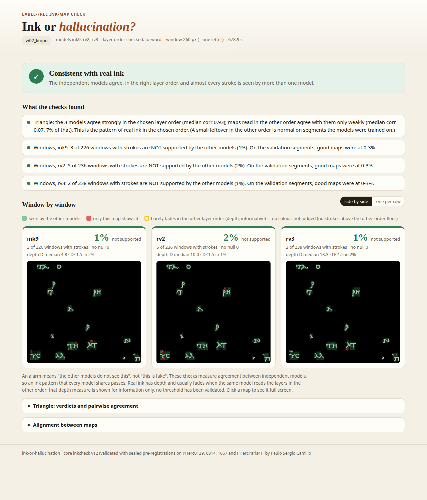
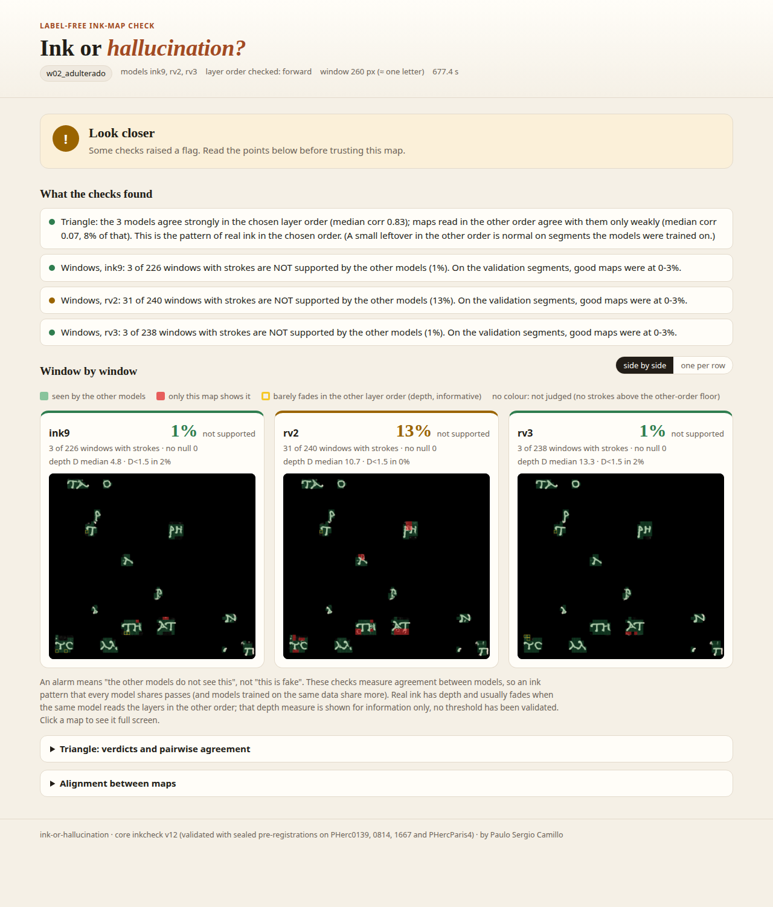
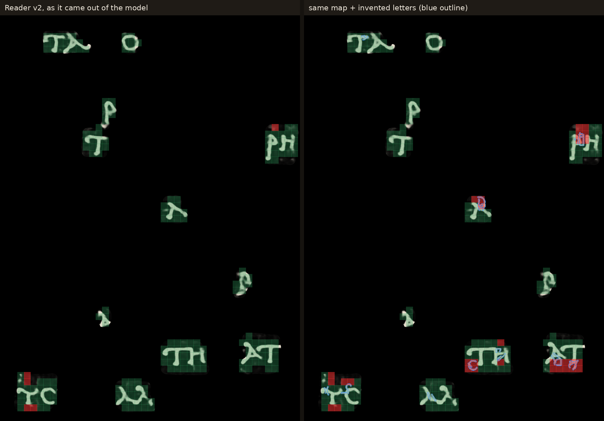
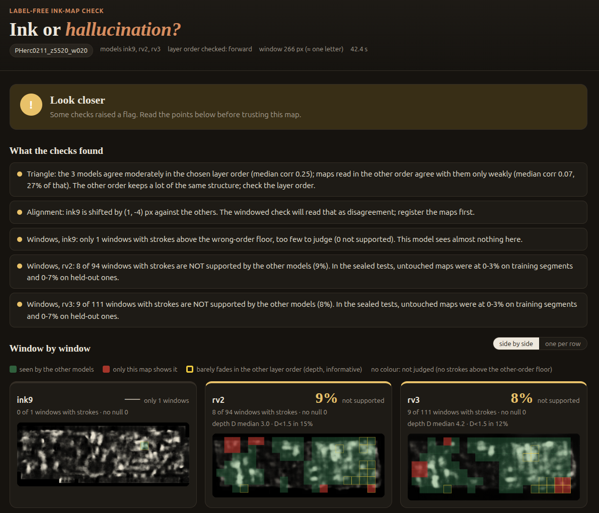
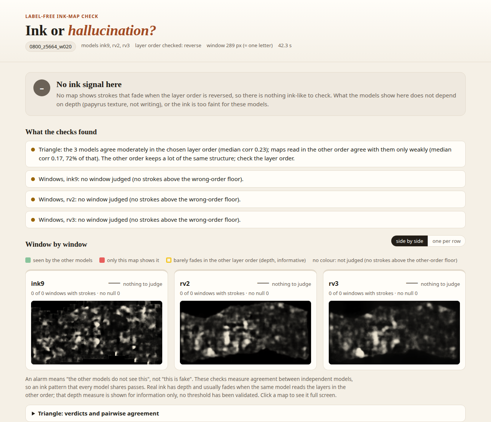
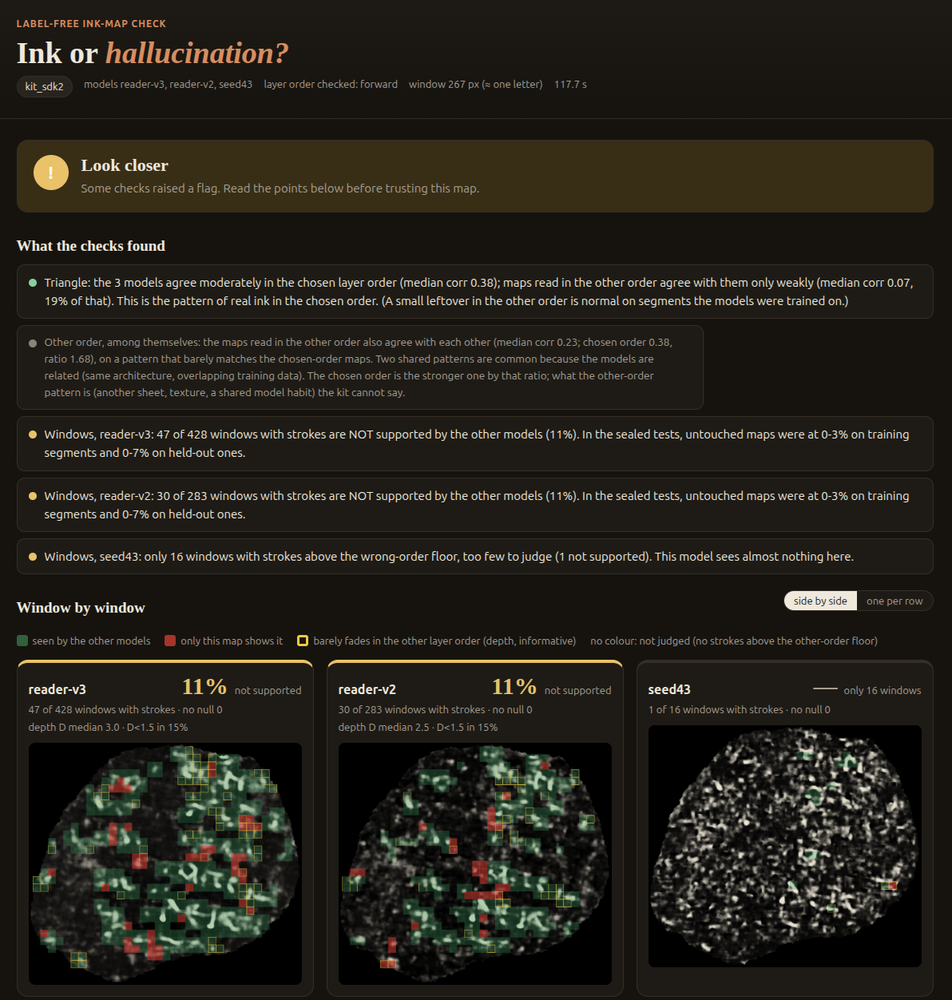

# ink-or-hallucination

[](https://github.com/pscamillo/ink-or-hallucination/actions/workflows/test.yml)

Label-free checks for 2.5D ink maps: does a map show ink, or something a model made up?

New 9 µm ink models keep coming, each with cleaner-looking maps, and someone reviewing a claimed letter cannot tell
from the map alone whether it is ink or something the model drew. This kit gives a label-free answer from what the
models do: read the same segment with three models, each in both layer orders, and it tells you whether they agree
in the right order, and window by window where one map shows strokes the others do not. Every core check (layer order,
triangle, windows, tie-break) was tested with a sealed pre-registration on public labelled segments before being
trusted; the report's summary bars (5% / 20%, 20 windows) are conveniences, not sealed rules.

| clean map | the same map with invented letters |
|---|---|
|  |  |

*The HTML report on PHercParis4 w02. Left: the three models as they came out. Right: the same segment with invented
letters planted in Reader v2. Only that map goes up (1–2% → 13%), and its red windows land on the planted letters (an illustrative run, not
a sealed result):*



## What it checks, and how well

| check | question | record (sealed, public data) |
|---|---|---|
| **layer order** | which way should the render's layers be stacked for the 9 µm models? (mesh + CT only, before running any model) | **60/60** (segment, model) pairs, 20 segments, 4 scrolls, all in the training data. Off it, the rule decided **1 of 6** labelled segments (right) and abstained on 5 (CT match < 0.5) |
| **triangle** | do 3+ models agree on this map beyond chance, in that order and not in the other? | the right-order maps agree beyond chance in **14/14** segments; a wrong-order map is flagged in only **8/14** (PHerc1667 6/6, PHercParis4 2/8): where the wrong order keeps some ink signal it agrees with the core, so that flag is not a reliable alarm (`docs/NOTE_2026-10-27_TRIANGLE_REREAD.md`) |
| **windows** | where does one map show strokes the other models do not? | PHercParis4 (a training scroll; blind for the windowed check, labels opened last): **2.7%** false alarm; windows with an isolated invented letter flagged **81/81**; windows where invented letters sit on real text **26%** (counts are overlapping windows, not letters) |
| **natural hallucinations** | does it flag the mistakes models make on their own? | where a model draws strokes and the label has no ink: flagged **28%** vs **1.6%** on real ink (18×, p ≈ 1e-87; blind for the windowed check) |
| **off the training data** | does it still work on segments the models were not trained on? | 6 labelled segments, 4 scrolls: the order was decided on **3 of 6**, all **3 right**; the kit abstained on the other 3 (PHerc0841, before the tie-break existed; that scroll then calibrated it). PHerc0500P2 + 0009B (held-out segments, blind): tie-break **2/2**, false alarm **5.6%**, invented-letter windows **4/4** isolated and **29%** on text, triangle on wrong-order maps **1/2 FAIL**. PHerc1447 w060 (no model saw it, reads **reversed**, blind): geometry rule right, false alarm **1%**, v8-in (another architecture) agrees |
| **depth** (informative) | does a stroke fade when the same model reads the layers in the other order? | real ink fades more than model-made strokes (AUC 0.76 on one set; 0.646 on another, below the 0.65 bar: FAIL). Shown, not used for a verdict |

## Scope and limits

- **It measures agreement, not truth.** An ink pattern that every model shares passes.
- **The three models are not independent.** All three are villa's hybrid 3D/2D network with overlapping training
  data; Reader v2 has its own labels and a larger set (it also trains on segments of PHerc0500P2, 0009B, 0343P and
  0172), and Reader V3 is Reader v2 trained further. Their agreement rules out chance, not a pattern they learned
  from the same data. (Read field by field from the checkpoints' own configs: `scripts/onde_treino.py`.)
- **Little data off the training set.** Most labelled tests ran on segments the models were trained on. On
  PHerc0841, a scroll none of them saw, the kit abstained on all three segments. A sealed tie-break (the stronger of
  the two model trios fixes the order) then decided the labelled segments of PHerc0500P2 and PHerc0009B, right on
  both. Those two segments are in no model's training data, but Reader v2 and V3 trained on other segments of both
  scrolls (`docs/ERRATUM_HELDOUT2.md`; the prereg first said otherwise). On PHerc1447 w060, which no model saw and
  which reads reversed, the geometry rule decided the order before any model ran, and was right; v8-in, a model of
  another architecture that never saw PHerc1447, agreed with the kit's core. Six labelled segments in all, the
  order decided on three, all right: consistent with rules that work, not an error rate. (Rerun later with the
  guarded tie-break, PHerc0841's three segments all come out forward, as the labels prefer; that scroll calibrated
  the tie-break, so this is not evidence.) Picking **reverse** with the tie-break is still untested (on PHerc1447
  the geometry rule decided first). The labels of these scrolls may come from a model.
- **Mirror patterns.** Read in the wrong order, the three related models often agree with each other on a different
  pattern. The triangle's verdict on a wrong-order map is then not reliable (it failed on PHerc0009B and, re-read,
  on 6 of 8 PHercParis4 segments); the report shows that agreement as a grey note and does not use it for the
  verdict. The order comes from the geometry rule or the tie-break, not from that verdict.
- **Most invented letters sitting on real strokes are missed:** two thirds to three quarters of such windows. A sealed
  attempt to fix this (flagging the largest connected piece of unexplained strokes, v13) caught more of them but
  raised the false alarm above 5% off the training data, and failed (`docs/RESULT_UCOMP.md`); the kit keeps v12.
- **A model that draws differently from the others gets more alarms.** An alarm means "the other models do not see
  this", not "this is fake".
- **The windowed score assumes pixel-aligned maps.** The report measures the shift between maps and warns.
- **Scope.** Tested with the 9 µm koine models (ink_9um, Reader v2, Reader V3); the layer-order rule's "reverse"
  case rests on one calibration segment and one blind test (PHerc1447 w060). Tested on Linux with real data; the
  checks and the report also pass on Windows and macOS (CI on synthetic segments, every push); the end-to-end demo needs
  `vc_render_tifxyz` and a CUDA GPU.

## Possible next steps

Directions, not promises: none of these is tested yet.

- **Order from geometry alone.** Off the training data the CT match was too weak for the order rule on 5 of 6
  labelled segments. The direction to the scroll's umbilicus also says which side of the sheet is outside, with no
  CT match needed.
- **A CT-texture check.** Score how much a map's strokes follow the papyrus texture in the CT. Models that agree
  because they all trace fibres would then be caught, not counted as agreement on ink.
- **A model of another family in the core.** On PHerc1447 w060, v8-in (another architecture) agreed with the villa
  models' core. Requiring one such model in the core would rule out patterns the related villa models learned
  together.
- **Invented letters inside real text.** Flagging the largest connected piece of unexplained strokes caught more of
  them but failed on false alarms, almost all from one model (`docs/RESULT_UCOMP.md`). A false-alarm control per
  model is the obvious next try.
- **Depth.** Real ink fades more than model-made strokes when the layer order is flipped on one test set (AUC 0.76)
  but not on another (0.646, below the sealed 0.65 bar); shown in the report, not used for a verdict.

## On scrolls with no labels

Usage examples, not evidence: with no labels there is no right answer to score. Four segments of four scrolls, all
from the public [mesh package](https://github.com/pscamillo/vesuvius-eligible-meshes), on scrolls that, as far as
the checkpoints' own configs show (`scripts/onde_treino.py`), none of the three models was trained on. After PHerc0800, one mesh per scroll was picked by a rule written
before running: among the meshes judged good, the one whose ink_9um map changes most when the layer order flips
(`scripts/escolhe_exemplo.py`, ranking in `docs/examples/escolha_exemplo.json`). Then `demo_unlabelled.py`, unchanged.

| scroll, mesh | layer order | what the kit says |
|---|---|---|
| PHerc0813 z13696_w020 | rule abstained (CT match 0.40); both orders equally strong (ratio 1.04) | **no verdict**: it stops before the report |
| PHerc0125 z6944_w020 | rule abstained (CT match 0.15); tie-break: forward (1.34) | **Look closer**: the maps read in the other order agree with the chosen ones just as much (120%), so what the models share here does not depend on the order: texture more than ink |
| PHerc0211 z5520_w020 | rule abstained (CT match 0.35); tie-break: forward (1.28) | **Look closer**: Reader v2/V3 strokes fade when the order flips, as ink does, but 8–9% of their windows are not backed by the other models and ink_9um sees almost nothing |
| PHerc0800 z5664_w020 | rule abstained (CT match 0.46); no group of maps in one order (before the tie-break) | **No ink signal here** |

None of the four says "consistent with real ink". On scrolls the models were not trained on, that is the honest
answer: the kit says what it can see and stops where it cannot.



*PHerc0211 z5520_w020: two related models see something that depends on depth, the third sees nothing, and about
one window in eleven is not backed by the others. "Look closer" is the right verdict for that.*

`demo_unlabelled.py` on a public mesh of PHerc0800 (z5664, w020; an illustrative run): the layer-order rule abstained (CT match 0.46,
below 0.5), and with the order unknown the triangle found no group of maps that agree in one order only. The
report says so instead of guessing:



*"No ink signal here" is a result, not a failure: on this segment the kit cannot tell ink from what the models
would draw anyway. (This run predates the tie-break and was not rerun. With no order decided, that earlier demo
still drew the report with the stored layers reversed, so its header reads "layer order checked: reverse"; neither
order was supported. The current demo stops there instead.)*

<details>
<summary><b>Quick start</b></summary>

```bash
pip install -r requirements.txt                     # + streamlit for the app
# a folder per segment: NAME.tif and NAME_reverse.tif for each model, optional mask.npy
python segment.py SEGMENT_DIR --models ink9 rv2 rv3 --px-um 9.6 --order forward
#   -> SEGMENT_DIR/inkcheck_report/report.html (+ report.json, one PNG per map)
streamlit run app.py                                  # the same, point and click
```

Choosing the order (`--order`): use the layer-order rule before looking at any map.

```bash
python scripts/curvatura.py MESH_TIFXYZ --D 1000                 # which side the sheet curves to
python scripts/ordem_camadas.py MESH_TIFXYZ RENDER.zarr CT.zarr/0 # which way the stored layers grow
# the 9 um koine models want the stack from the OUTER face to the INNER face
```

`demo_unlabelled.py` does everything on one mesh of an eligible scroll: render (`vc_render_tifxyz`, public CT),
order rule, the three models in both orders, and the report.

**With ink-sdk.** After an [ink-sdk](https://github.com/LimeGS/ink-sdk) battery, point the kit at its folder:

```bash
python from_battery.py BATTERY_DIR OUT_DIR --centre 0 --step 1 --models reader-v3 reader-v2 dense-native
#   add maps from any other tool: --extra NAME=forward.npy,reverse.npy
```

It takes one cell per profile, puts every map on one grid and runs the same report. The order comes from
`--order` or from the maps alone (triangle core, else the tie-break with exactly 3 models). The kit does not need
ink-sdk installed, only its output folder; ink-sdk does not need the kit.



*PHerc0841 w00, read by three ink-sdk profiles, then `from_battery.py`. The order was chosen from the maps alone
(this scroll calibrated the tie-break, so this is an example, not evidence). seed43 sees almost nothing here, so each
Reader is backed by one model only: 11% of their windows go unsupported and the kit says "Look closer" instead of
"ink". The labels show the ink is real (AUC up to 0.91): an alarm means "the other models do not see this", not
"this is fake".*

As a library: `import inkcheck` (the sealed core: `check_triangle`, `check_local`, …) or `segment.run(...)`, which
returns everything as a dict. `inkcheck.py local` run by hand keeps older defaults; the sealed v12 settings are the
`V12` flags in `segment.py` (`--stroke floor --floor MAP --floor-k 2 --score both --null swap --n 19 --min-null 10`
…), which `segment.py` always passes.
</details>

<details>
<summary><b>How each check works</b></summary>

**Layer order.**
- `curvatura.py` measures, from the mesh alone, which side of the sheet is concave: the median sagitta at
  1000 voxels gives the outward normal.
- `ordem_camadas.py` samples the CT along that normal and matches each stored layer to a depth. The slope says
  which way the layers grow.
- The 9 µm models want outer → inner. The rule abstains if the sheet is too flat, the CT match is weak
  (median corr < 0.5) or the slope is small (|slope| < 0.5).
- If it abstains: the triangle's unique core of 3+ maps, all in one order, decides. If there is none (both orders
  form a group), the **trio-strength tie-break** (PREREG_HELDOUT2): for each order, the median correlation of its
  three maps; the stronger order wins if it is ≥ 1.25 × the other, else no verdict. Also no verdict if the
  stronger trio does not all agree or a median is ≤ 0 (a guard added after the seal,
  `docs/NOTE_2026-10-27_TIEBREAK_GUARD.md`).

**Triangle.**
- Every pair of maps is correlated at stroke scale (2–20 px band) against a null that shuffles blocks inside the
  valid area.
- The core is the unique largest group of 3+ maps that all agree, with p < 0.01 and corr ≥ 2 × the null maximum.
- With `--core-from` fixed to the predicted order, every other map is judged against that core.

**Windows** (window = one letter, about 2.5 mm).
- **Judged:** a window is judged if its stroke energy is ≥ 2 × the median energy of the same model in the wrong
  order (the "no ink" floor).
- **Correlation test:** the window is unsupported if its correlation with the mean of the other maps does not beat
  every valid swap with a far window of the same mask (19 drawn, at least 10 valid).
- **Unexplained strokes U:** the window is also unsupported if U is an outlier for that map. U is the fraction of
  this map's stroke pixels with no stroke of any other map within 6 px.
- **No null:** a window without a valid null is "not judged", never "unsupported".
- **Too few windows:** a map with fewer than 20 judged windows is reported as "too few to judge"; its fraction does
  not count toward the verdict (1 of 3 is not 33% of anything).

**Depth (informative).** D = stroke energy in the chosen order / in the other order, same model, per window.
</details>

<details>
<summary><b>Pre-registration trail</b></summary>

Every test was written down and sha256-sealed **before** it was run. Results were sealed as they came out,
failures included. Each fix went into a new pre-registration on data the check had not seen.

| # | prereg | data | outcome |
|---|---|---|---|
| 1 | TRIANGULO | PHerc1447 w058 | triangle alone failed (mirror group) → led to the order rule |
| 2 | ORDEM | PHerc0139 ×5, 0814 ×1 | order 18/18 PASS; triangle 3/6 FAIL (null bug: NaN draws) |
| 3 | V3 | PHerc1667 ×6 | order 18/18 PASS; triangle 6/6 PASS after the fix |
| 4 | V4 | PHerc1667 ×6 | blind probes isolated 6/6; partial invented letters not caught at map level |
| 5 | PARIS4 | PHercParis4 ×8 | order 24/24 PASS; triangle 8/8 PASS as printed, **2/8 FAIL** re-read (a printing bug hid wrong-order maps that agree with the whole core; NOTE_2026-10-27_TRIANGLE_REREAD); windows v10 FAIL (null bug: +inf) |
| 6 | V11 (+ addendum) | 12 segments | windows v11: false alarm 1/851 PASS; no-null 0.4% PASS; invented letters 10/19 FAIL |
| 7 | V12 | PHercParis4 ×8 (blind) | windows v12: 4/4 PASS; v11 on the same data 3/3 PASS |
| 8 | NATURAIS | PHercParis4 + 12 segments | natural hallucinations flagged 18× / 7.7× more than real ink: PASS, PASS |
| 9 | DIRECAO | PHercParis4 + 12 segments | depth separates them: PASS (AUC 0.76) / FAIL (AUC 0.646) |
| 10 | ESTRESSE | PHercParis4 ×3, noisy renders | fail-safe triangle 6/6 PASS, but it could not fail with the core fixed by the order (withdrawn, see the NOTE); false alarm 4.1% / 3.5% PASS |
| 11 | HELDOUT0841 | PHerc0841 ×3, no model trained on it | order rule abstained on all 3 (CT match < 0.5), triangle found no core: no verdict, every criterion NOT TESTABLE |
| 12 | HELDOUT2 | PHerc0500P2 + PHerc0009B, blind (held-out segments; Reader v2/V3 saw other segments of both, see ERRATUM_HELDOUT2) | tie-break decided 2/2, both right: PASS; order 6/6 PASS; false alarm 5.6% PASS; invented-letter windows 4/4 and 29% PASS; triangle 1/2 FAIL; natural hallucinations NOT TESTABLE (16 < 20 windows) |
| 13 | HELDOUT3 | PHerc1447 w060 (no model saw it, reads reversed) + w062 unlabelled | order rule decided reverse: PASS; v8-in witness agrees with the core: PASS; false alarm 1% PASS; invented-letter windows 3/4 and 26% PASS; v8-in windows, triangle H2, natural hallucinations NOT TESTABLE |
| 14 | UCOMP | PHerc0841 ×3, 0500P2, 0009B, 1447 w060 (off the training data, new invented letters) | v13 (largest connected piece of unexplained strokes): windows with letters on text 39.6% vs v12 33.7%, needed +10 points: **FAIL**; false alarm 6.4% vs 4.6%, above 5%: **FAIL**; isolated-letter windows 10/11 PASS. v12 stays |

Every file and its sha256 is in `docs/` (`SHA256SUMS`). The results cite their pre-registrations, and several
pre-registrations cite the record before them, by sha256: all 25 such citations match the files. Dated notes
(`ERRATUM_HELDOUT2`, `NOTE_2026-10-27_TRIANGLE_REREAD`, `NOTE_2026-10-27_TIEBREAK_GUARD`,
`NOTE_2026-10-27_REVIEW2`) correct earlier files
without editing them. The natural-hallucination results (#8) are in `RESULT_V12.md`.

Three gaps, stated plainly:
- The `inkcheck.py` cores used in #1 (md5 149b7fd6, 5e43074c) were not kept. That test failed, and it only led to
  the order rule; no result below it rests on that code.
- The first `fase6.py` (md5 85bd1f37) crashed on its first segment and was replaced by 4dab3cf9, as the V11
  addendum records.
- The run scripts of #2 (`geometria.py`, `fase2.py`) were not md5-sealed. They are shipped in `scripts/`, but
  nothing proves they are byte-identical to what ran. Helper scripts the docs cite without a seal are shipped
  too, except `prep_1667.sh` (#3), which was not kept.
</details>

<details>
<summary><b>Repository layout</b></summary>

```
inkcheck.py        sealed core (v12, md5 96c8d45f…): direction, label, witness, triangle, local
segment.py         one command for a whole segment -> HTML/JSON report
app.py             Streamlit front end
demo_unlabelled.py end-to-end demo on an unlabelled mesh of an eligible scroll
from_battery.py    the kit on an ink-sdk battery folder
scripts/           order-rule tools, every sealed run script (byte-identical to what the preregs hash) and helpers
versions/          the cores the sealed runs used (v6, v7, v10 = inkcheck.py, v11, v12; v13 tested and not adopted), byte-identical
docs/              PREREG_*.md, RESULT_*.md and their sha256
figures/           the README figures
LICENSE            MIT
requirements.txt   numpy scipy tifffile imagecodecs pillow zarr
tests/             synthetic tests (ink, texture only, one model inventing strokes, tie-break, ink-sdk folder)
.github/           CI: the tests on Linux, Windows and macOS
```

The run scripts in `scripts/` keep their original Portuguese comments and output, so their md5 still match the
pre-registrations.
</details>

---

By Paulo Sergio Camillo. Models: `ink_9um` and the Reader models (Vesuvius Challenge / villa ink-detection).
Data: Vesuvius Challenge open data; meshes for the demo from
[vesuvius-eligible-meshes](https://github.com/pscamillo/vesuvius-eligible-meshes). MIT license.
